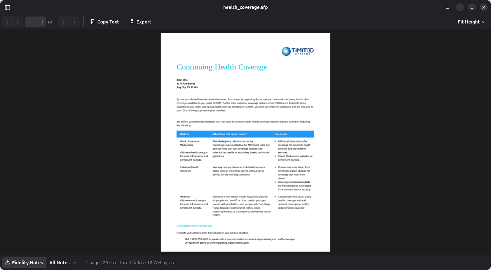
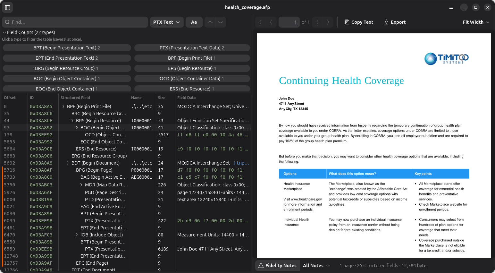

# rafp

A GNOME desktop application for reading and inspecting **AFP** (Advanced Function
Presentation / MO:DCA) files, written in Rust.





The window splits in two panes that are linked together:

- **Inspector**: the full structured-field table.
  - Each field shows its offset, ID, name, token and size, plus a readable
    one-line decode: PTX/NOP/TLE text, page and image geometry, font metrics,
    code pages and object maps.
  - Select a field to jump to its page and flash the content it produced;
    expand it (arrow, double-click or Enter) to see its decoded triplets.
  - Filter by field type (several types at once).
  - Find text in PTX, NOP or TLE fields, or by field type, with a case toggle
    and previous/next.
- **Render**: each page, rasterized with resvg.
  - Navigation, zoom (fit width, fit height, 50–400 %, or 10–800 % with
    Ctrl + wheel), and the pointer position in millimetres.
  - Copy the page's text, export all text to `.txt`, export the document or
    the page as PDF (vector, with selectable text), or the page as SVG or
    PNG (300 dpi).
  - Optional *fidelity notes* overlay, which explains where the render
    approximates the original (substitute fonts, estimated sizes, omitted
    glyphs, fallback code pages, CMYK compositing).
  - Clicking rendered text selects the field that produced it.

The interface is a native GTK 4 / libadwaita application. Open a file from the
**☰** menu (or Ctrl+O), by dropping it on the window, or by passing its path to
`./run.sh`. The **☰** menu (top right) holds Open AFP File, the default text
encoding, the small-font option and About; the button at the top left shows or
hides the inspector. Document details (pages, fields, size, declared code
pages) are shown in the footer under the page.

| Keys                             | Action                                                             |
|----------------------------------|--------------------------------------------------------------------|
| Ctrl+O                           | Open a file                                                        |
| Ctrl+F                           | Find (shows the inspector if hidden)                               |
| Enter / Shift+Enter              | Next / previous match                                              |
| F9                               | Show or hide the inspector                                         |
| Page Down / Page Up              | Next / previous page (pointer or focus in the page pane)           |
| Ctrl+plus / Ctrl+minus / Ctrl+0  | Zoom in / out / real size (also Ctrl + wheel, or a touchpad pinch) |
| Enter or double-click on a field | Expand its triplets                                                |
| F10                              | Main menu                                                          |
| Ctrl+Q                           | Quit                                                               |
Banners warn about page-less **AFP resources** (fonts, overlays, images) and
about **missing resources** (fonts the document references but does not embed).

## What it decodes

| Architecture | Coverage                                                                                                                                                        |
|--------------|-----------------------------------------------------------------------------------------------------------------------------------------------------------------|
| MO:DCA       | Structured fields, triplets (about 15 decoded in detail), MCF format 1 and 2, MDR, MPO, IPO, IPS, IOB, object containers                                        |
| PTOCA        | Positioning, rules, colors (STC/SEC), STO rotation, SVI justification, MCF/MDR fonts and code pages, implicit pagination of loose text                          |
| IOCA         | Uncompressed bilevel, grayscale and RGB; IBM MMR (G4); TIFF LZW; JPEG; banded CMYK (JPEG or LZW)                                                                |
| IM image     | Simple and celled IM/1 rasters                                                                                                                                  |
| BCOCA        | QR Code (other symbologies are reported and skipped)                                                                                                            |
| GOCA         | Lines, boxes, full and partial arcs, Bézier curves, fillets, area fills, colors, line types                                                                     |
| FOCA         | Raster fonts; Adobe Type 1 and CFF / CID-keyed outline fonts; specimen pages for font resources; document text drawn in the file's own embedded fonts           |
| Code pages   | EBCDIC cp037, cp273, cp424, cp500, cp875, cp1026, cp1047, cp1140, cp1141; DOS/Windows single-byte pages; UTF-8, UTF-16BE, Latin-1, Shift-JIS, GBK, EUC-KR, Big5 |

## Install

On Ubuntu 24.04 or later, or Debian 13 or later, download the `.deb` package
from the [latest release](https://github.com/vxel/rafp/releases/latest), then:

```bash
sudo apt install ./rafp_*_amd64.deb
```

It adds rafp to the applications menu and opens `.afp` files from the file
manager.

## Build and run

You need Rust 1.92 or later, and the GTK 4 (4.12+) and libadwaita (1.5+)
development files. On Debian / Ubuntu:

```bash
sudo apt install libgtk-4-dev libadwaita-1-dev gettext
```

```bash
./run.sh [path/to/file.afp]   # builds if needed, then launches
```

To get a menu entry on Linux (it installs `~/.local/bin/rafp`, its
translations, its icon, the AFP file type so that `.afp` files open with rafp,
and a `.desktop` file named after the application id, `org.delaunois.Rafp`):

```bash
tools/install-desktop-linux.sh
```

To build the Debian package (into `target/debian/`), with
[cargo-deb](https://github.com/kornelski/cargo-deb) and `dpkg-dev` installed:

```bash
tools/build-deb.sh
```

Pushing a tag such as `v0.1.0` (matching the version in `Cargo.toml`) builds
the package on GitHub and attaches it to a release.

### Command-line dump

`afp-dump` prints the same analysis without a window:

```bash
cargo run --release -p afp-dump -- file.afp            # field list with decoded summaries
cargo run --release -p afp-dump -- --text file.afp     # extracted text
cargo run --release -p afp-dump -- --svg out/ file.afp # one SVG per page
cargo run --release -p afp-dump -- --pdf out.pdf file.afp # all pages as one PDF
cargo run --release -p afp-dump -- --json file.afp     # full inspector + page model
```

`--codepage CP` sets the code page for text whose font declares none (default
`cp500`), and `--embed-small-fonts` draws small text in the file's embedded
raster fonts, like the viewer's option.

### Environment variables

| Variable | Effect |
|---|---|
| `RAFP_START_DIR` | Folder the file dialogs start in until a file is opened (`run.sh` sets it to the current folder) |
| `RAFP_LOCALEDIR` | Folder with the compiled translations, instead of the installed or built ones |
| `RAFP_SCREENSHOT` | Capture the window to this PNG once the page is rendered, then quit (see `crates/afp-viewer/src/screenshot.rs` for its options) |
| `RUST_LOG` | Log level (`warn` by default) |

### Translations

The interface is available in English and French, following the desktop
language. AFP content (field names, decoded summaries, fidelity notes) stays
in English, the language of the AFP specifications. Translations use gettext:

```bash
tools/update-po.sh     # extract the strings into po/rafp.pot and merge po/*.po
```

To add a language, add its code to `po/LINGUAS`, run `tools/update-po.sh`,
then translate the new `po/<code>.po`.

## Project layout

```
crates/
  afp-core/     library: parsing, decoding, page model, SVG rendering (no UI)
    src/parser.rs        MO:DCA structured fields and their IDs (parser::sf)
    src/triplets.rs      triplets and MCF helpers
    src/codepages/       code page tables (tables.rs is generated)
    src/inspect.rs       inspector rows, summaries, resource diagnostics
    src/dump.rs          JSON view of an inspection (afp-dump --json, snapshots)
    src/ptoca/           text interpreter (text.rs) and page extraction (pages.rs)
    src/ioca.rs ccitt.rs imimage.rs goca.rs bcoca.rs foca.rs type1.rs cff.rs
    src/outline.rs       outline glyphs shared by the Type 1 and CFF interpreters
    src/render_svg.rs    page → SVG
    src/raster.rs        SVG → pixels with resvg (feature `raster`)
    src/pdf.rs           pages → PDF with krilla (feature `pdf`)
  afp-viewer/   the GTK 4 / libadwaita desktop application (binary `rafp`)
  afp-dump/     command-line dump
po/             translations (gettext)
data/           desktop entry and file type templates, icons, screenshots
tools/          code page table generator, translation update, installer, Debian package
```

## License

Copyright (c) 2026 Cédric de Launois
MIT - see [LICENSE](LICENSE).

## Acknowledgements

Initially ported from [readAFP](https://github.com/bone1966/readAFP) by Keith Lutz.
Coded with Claude Code.